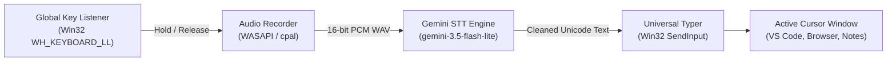

<div align="center">

# 🎙️ Venessa

**Ultra-lean, high-speed Windows voice dictation powered by Google Gemini.**  
*Dictate anywhere with a single keystroke. Clean prose, zero bloat, runs at ~11 MB of RAM.*

[](https://www.rust-lang.org/)
[](https://microsoft.com/windows)
[](https://github.com/smithcooks/Venessa)
[](https://aistudio.google.com/)
[](LICENSE)

</div>

---

## ⚡ Why Venessa?

Modern desktop voice-to-text tools (Wispr Flow, Superwhisper, OpenWhispr) rely heavily on Electron, Chromium runtimes, and local neural network models. On everyday PCs and laptops, this means:
- **1.2 GB to 2.5 GB of RAM** constantly tied up.
- Sluggish startup times and battery drain.
- Raw speech output full of verbal stumbles (*"um"*, *"uh"*, accidental restarts).

**Venessa is a complete rewrite in pure Rust.** It strips away all browser engines, local model bloat, and web runtimes, replacing them with an ultra-lightweight native Win32 background service that talks directly to the **Google Gemini API**.

---

## 📊 Performance Benchmark

| Metric | Traditional Electron Voice Apps | **Venessa (Rust)** | Improvement |
| :--- | :--- | :--- | :--- |
| **RAM Footprint (Idle)** | 1,200 MB – 2,200 MB | **~11.1 MB** | **> 99% reduction** |
| **CPU Usage (Idle)** | 1.0% – 5.0% | **0.0%** | **Near zero** |
| **Binary Size** | 180 MB – 450 MB | **3.3 MB** | **98% lighter** |
| **Startup Time** | 5 – 10 seconds | **< 50 milliseconds** | **Instant** |
| **Local Models on Disk** | 2 GB – 6 GB (ONNX / GGUF) | **0 MB** (Cloud STT) | **Zero disk clutter** |

---

## ✨ Features

- 🎯 **Push-to-Talk (Hold-to-Speak):** Hold your designated hotkey (e.g., `Alt`, `Ctrl+Space`, or `F8`) to record your voice. Release the key to immediately transcribe and type. Zero missed keystrokes or lag.
- 🔄 **Toggle Mode Option:** Prefer not holding a key? Switch to `toggle` mode: press once to start recording, press again to stop.
- 💊 **Floating Status Pill Overlay:** A sleek, non-intrusive floating status indicator (`🎙️ Listening...`, `⏳ Transcribing...`) appears on screen and automatically hides when done. Built with zero-focus Win32 GDI—it never steals cursor focus or interrupts your typing.
- 🔊 **Clear Acoustic Feedback:** Crisp, pleasant audio cues confirm state transitions:
  - High tone on recording start
  - Processing tone on recording stop
  - Cheerful ping when text is typed
  - Distinct double-buzz on errors
- 🧠 **AI Disfluency Cleanup:** Transcriptions are automatically cleaned by Gemini to eliminate stuttering, filler words (*"um"*, *"uh"*, *"like"*), while preserving your exact meaning, vocabulary, and tone.
- ⌨️ **Universal Unicode Auto-Typing:** Injects text character-by-character into whatever window has cursor focus using native Windows `SendInput` with Unicode support. Works everywhere:
  - **Browsers:** Chrome, Firefox, Edge, Brave
  - **Code Editors:** VS Code, Visual Studio, JetBrains, Sublime Text, Cursor
  - **Office / Notes:** Notion, Word, Google Docs, Obsidian, OneNote
  - **Chat & Social:** Discord, Slack, Telegram, WhatsApp, Teams
  - **Terminals:** Windows Terminal, PowerShell, CMD, Git Bash
- 🪟 **Built-in Settings GUI:** Configure your Gemini API key, model, hotkeys, trigger mode, audio feedback, and prompt in a clean, native Windows dialog without editing config files.
- 🔄 **Runs in the Background on Close:** Closing the Settings GUI keeps Venessa running silently in the Windows system tray. Double-click the tray icon or right-click and select **"⚙️ Settings..."** anytime to reopen.
- 🔔 **Native Windows Toast Notifications:** Instant status and clear error reporting from the system tray if an API key or network issue arises.
- 🛡️ **Zero Clipboard Pollution:** Types characters directly instead of overwriting your Windows clipboard.

---

## 🏗️ Architecture



1. **Hotkey Subsystem:** A low-level keyboard hook (`WH_KEYBOARD_LL`) captures exact key-down and key-up events with zero CPU overhead, supporting both single modifier keys (`Alt`, `Ctrl`, `Shift`, `CapsLock`) and compound shortcuts (`Ctrl+Space`, `Alt+Space`).
2. **Audio Pipeline:** Captures high-fidelity microphone input via Windows WASAPI (`cpal`), normalizes PCM samples, and compiles an in-memory 16-bit mono WAV buffer (`hound`).
3. **Speech-to-Text & Resilience:** Sends the WAV buffer as base64 inline audio to the Google Gemini API with automatic fallback across models (`gemini-3.5-flash-lite`, `gemini-3-flash-preview`, `gemini-3.1-flash-lite`).
4. **Auto-Typing Subsystem:** Decodes the transcribed response into UTF-16 code units and dispatches `INPUT_KEYBOARD` events with `KEYEVENTF_UNICODE` directly to the foreground window.

---

## 🚀 Getting Started

### 1. Requirements
- Windows 10 or Windows 11 (64-bit)
- A working microphone
- A free **Google Gemini API Key** ([Get your key here from Google AI Studio](https://aistudio.google.com/app/apikey))

### 2. Quick Launch
Clone the repository and build:
```powershell
git clone https://github.com/smithcooks/Venessa.git
cd Venessa
cargo build --release
```

Or run the batch launcher:
```powershell
.\Run-Venessa.bat
```

For silent background execution (no console window):
```powershell
wscript .\Run-Venessa-Silent.vbs
```

---

## ⚙️ Configuration

Venessa automatically creates and manages its configuration file at:
```text
%APPDATA%\Venessa\config.toml
```

You can open and edit it at any time via the **Settings GUI** or by **right-clicking the Venessa tray icon** and selecting **"Open Config File (config.toml)"**.

### Default Configuration (`config.toml`)

```toml
# ==============================================================================
# Venessa - Ultra-lean Voice Typing Configuration
# Edit this file or use the Settings GUI to apply changes.
# ==============================================================================

# Your Google Gemini API Key (Required)
# Get a free key at: https://aistudio.google.com/app/apikey
gemini_api_key = "YOUR_GEMINI_API_KEY_HERE"

# Gemini model to use for speech-to-text
# Options: "gemini-3.5-flash-lite" (Recommended), "gemini-3-flash-preview", "gemini-3.8-flash"
gemini_model = "gemini-3.5-flash-lite"

# Global hotkey to trigger recording
# Examples: "Alt", "Ctrl+Space", "Alt+Space", "Ctrl+Shift+V", "F8", "CapsLock"
hotkey = "Ctrl+Space"

# Trigger mode:
# "hold"   -> Push-to-Talk (hold hotkey to record, release to transcribe)
# "toggle" -> Press hotkey once to start, press again to stop
mode = "hold"

# Typing delay in milliseconds between characters (2 is default, 0 for instant)
type_delay_ms = 2

# Audio cues on recording start/stop/success/error
sound_feedback = true

# Instruction prompt passed to Gemini for transcription & cleanup
prompt = "Please transcribe this audio accurately. Lightly clean up speech disfluencies (such as filler words like um, uh, stutters, and accidental repetitions) while preserving the exact intended meaning, vocabulary, and natural tone of the speaker. Format with proper capitalization and punctuation. Return ONLY the transcribed text without any introductory remarks, notes, quotes, or conversational commentary."
```

---

## ⌨️ Hotkey Customization Guide

Venessa supports any combination of modifiers and keys:

| Shortcut | Description |
| :--- | :--- |
| `Alt` | Single-key Push-to-Talk using the Alt key. |
| `Ctrl+Space` | Accessible thumb combo. |
| `Alt+Space` | Convenient thumb trigger. |
| `Ctrl+Shift+V` | Classic dictation hotkey. |
| `F8` / `F9` / `F10` | Dedicated single-key trigger (no modifiers needed). |
| `CapsLock` | Turn your CapsLock key into a Push-to-Talk button. |
| `` ` `` *(Backtick)* | Top-left tilde key dictation. |

---

## 🔄 Auto-Start with Windows (Optional)

To have Venessa launch automatically whenever you turn on your PC:
1. Press `Win + R`, type `shell:startup`, and press **Enter**.
2. Right-click inside the folder, select **New > Shortcut**.
3. Point the shortcut to `Run-Venessa-Silent.vbs` or `target\release\venessa.exe`.
4. Click **Finish**. Venessa will now run silently in the background on startup.

---

## 🛠️ Building from Source

```powershell
# Clone the repository
git clone https://github.com/smithcooks/Venessa.git
cd Venessa

# Build optimized release binary
cargo build --release

# The compiled 3.3 MB binary is located at:
# target\release\venessa.exe
```

---

## 📜 License

This project is licensed under the **MIT License**. See the [LICENSE](LICENSE) file for details.

---

<div align="center">
Built with ❤️ in pure Rust by <a href="https://github.com/smithcooks">@smithcooks</a>.
</div>
